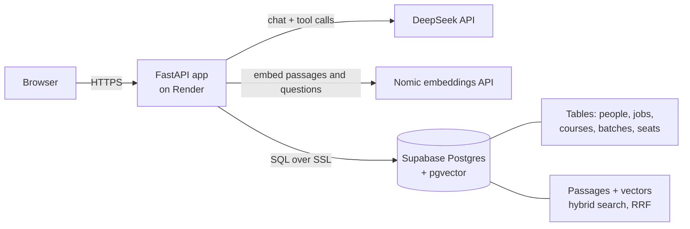

# Anchor

Anchor is a chatbot and admin tool for a maritime network of people,
ship managers and training institutes. Ask it in plain language who works
where, which courses have seats, or what people said in interviews.

**Live demo:** https://anchor-qe39.onrender.com. It runs on free hosting, so
the first visit after a quiet spell takes about a minute to wake up.

> All data in this repo (people, companies, courses, seat counts, interviews
> and sample PDFs) is fictional sample data.

## What it does

- **People search**: who works where, in which role, and whether a job is
  current or former.
- **Live seat availability**: seats left in each course batch, with how fresh
  the count is (`fresh` up to 1 day, `aging` up to 7 days, then `stale`). Who
  reported the count is never shown.
- **Interview answers with verified quotes**: answers drawn from interview
  transcripts and company documents. A quote is kept only if it appears word
  for word in the source passage.
- **Course updates from a PDF**: an admin uploads a course brochure.
  DeepSeek extracts the fee, duration and batches, and the admin reviews the
  draft next to the current values. Nothing is saved until the admin
  approves it.
- **Add interviews and documents with consent**: paste a transcript or
  upload a company PDF, preview the passages the chatbot will search, confirm
  consent, then publish. **Unpublish** removes them from search and keeps a
  record.
- **Admin login and audit trail**: scrypt-hashed passwords, 8-hour sessions
  and a login lockout. Every change records which admin made it, shown at
  `/admin/changes`.

## Architecture

The core is a **FastAPI** app:

- It serves the pages: landing `/`, chat `/ask` and admin `/admin`.
- `/chat` sends questions to **DeepSeek**, which answers by calling a small
  set of tools that read the database.
- The database is **Postgres with pgvector**, hosted on **Supabase**.
  Structured facts (people, jobs, courses, batches, seats) live in ordinary
  tables.

Interviews and documents are split into passages and embedded with
**nomic-embed-text** (through Nomic's API in production, or Ollama locally).
Search over the passages is **hybrid**: vector similarity finds passages with
the same meaning, and Postgres full-text search catches exact terms like
"ECDIS". **Reciprocal Rank Fusion** (RRF) merges the two rankings.

The app is hosted on **Render**.

## Key design decisions

- **Facts go in tables, stories go in RAG.** Names, jobs, fees and seat
  counts come from SQL, so they are exact and current. Only interview and
  document passages go through vector search.
- **Rules are enforced in code, not prompts.** The prompt asks the model to
  behave, and code checks the result before it is sent:
  - quotes not found in the sources are removed
  - internal IDs are removed
  - sentences about searches or tools are removed
  - a seat reporter's name never reaches the model at all
- **Never invent values.** If the data doesn't say, the answer is "I don't
  have that information". The PDF importer drops any extracted value that
  isn't in the PDF text, and leaves fields the PDF doesn't state unchanged.
  A batch with no stated capacity needs one typed in.
- **Consent and unpublish.** Interviews and documents can't be published
  without recording who gave consent, when, and which admin. Unpublishing
  deletes the passages from search but keeps the record. The ingest script
  never re-adds an unpublished interview.

## Run locally (Docker)

You need Docker, Python 3.14, [Ollama](https://ollama.com) and a DeepSeek API
key.

    cp .env.example .env              # add DEEPSEEK_API_KEY; set POSTGRES_PASSWORD
    docker compose up -d db           # Postgres + pgvector; loads schema and sample data
    ollama pull nomic-embed-text
    python -m venv .venv && source .venv/bin/activate
    pip install -r requirements.txt
    python -m scripts.ingest_transcripts
    python -m scripts.create_admin    # asks for the password at a hidden prompt
    uvicorn app.main:app --reload

Open http://localhost:8000 and log in at `/admin/login`.

**Demo files:**
- `samples/basic-safety-training-2027.pdf` (course update)
- `samples/interview-asha-rao.txt` (new interview)
- `samples/reset-demo.sql` (undoes the course update)

If your Docker database is older than the current schema,
`db/init/02-schema.sql` is safe to re-run on it.

## Deploy

Deployment uses Render plus Supabase, both on free plans, with Nomic
embeddings. The step-by-step guide is in [docs/DEPLOY.md](docs/DEPLOY.md). It
covers secrets, environment variables, and what resets when the free service
sleeps.
